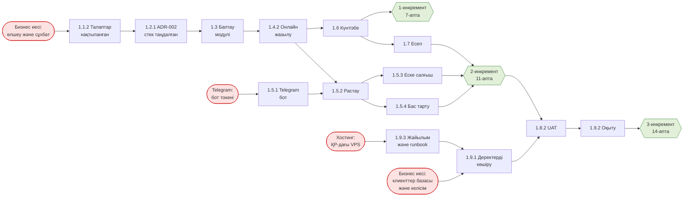

# «Жазыл» — тәуелділіктер картасы

Қызыл түйіндер — сыртқы тәуелділіктер, жасыл түйіндер — вехалар.

## Сыртқы тәуелділіктер

| Не керек | Кімнен | Растау күні | Нені бұғаттайды | Б жоспары |
|---|---|---|---|---|
| Бастапқы метрикаларды өлшеу және сұхбат | Әлібек Сапаров (орындалды) | 5-апта соңы | 1.1.2, 3-ЗЖ цифрлары | Ұқсас басқа бизнестен өлшем алу |
| Telegram бот токені және Bot API ережелері | Telegram (@BotFather) | 7-апта | 1.5.1–1.5.4 | Хабарламаларды тек поштамен жіберу |
| ҚР-дағы VPS және оның төлемі | hoster.kz, төлейтін — бизнес иесі | 10-апта | 1.9.3, 1.9.1, UAT | Басқа ҚР провайдері (PS Cloud) |
| Клиенттер базасы және ДД өңдеуге келісім | Әлібек Сапаров | 12-апта | 1.9.1 | Бос базадан бастау |
