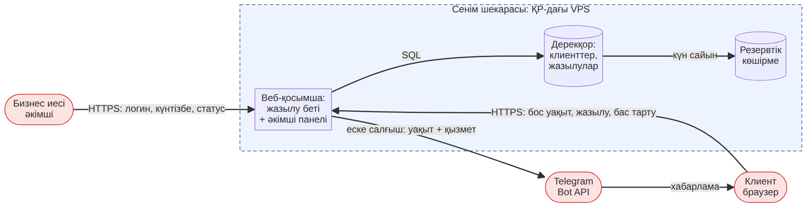

# Қауіп-қатер моделі (STRIDE)

Компонент: веб-қосымша (жазылу беті + әкімші панелі) және дерекқор. Сенім шекарасы — ҚР-дағы VPS.

| STRIDE | Қауіп | Шара | Статусы |
|---|---|---|---|
| S — жалған тұлға | Біреу құпиясөзді таңдап, Әлібектің атынан әкімші панеліне кіреді | Күрделі құпиясөз, 5 сәтсіз әрекеттен кейін 15 мин бұғаттау (ZHL-32) | Бэклогта, 10-апта |
| T — өзгерту | Клиент бас тарту сілтемесіндегі нөмірді ауыстырып, басқаның жазылуын жояды | Сілтемеде болжанбайтын токен (UUID), сервер токенді тексереді — ZHL-25 критерийіне қосылды | Критерийге енгізілді |
| R — бас тарту | Жазылу жойылды, бірақ кім жойғаны белгісіз: клиент пен иесі арасында дау | Әрекеттер журналы: кім, қашан, не өзгертті (ZHL-33); 22-бап 1-т. | Бэклогта, 10-апта |
| I — ақпараттың ашылуы | Бос уақыт беті басқа клиенттердің аты мен телефонын қайтарады | API тек бос уақытты қайтарады; тек HTTPS; ФЕТ-те тексеріледі | ФЕТ-те бар, 9-апта тест |
| D — қызметтен бас тарту | Скрипт жалған жазылулармен бүкіл күнтізбені толтырады | Бір нөмірден күніне 2 жазылу шегі, IP бойынша сұраныс жиілігін шектеу (ZHL-34) | Бэклогта, 11-апта |
| E — құқықты көтеру | Әкімші панелінің ашық мекенжайы арқылы клиент әкімші құқығын алады | Клиенттерде тіркелгі жоқ; әкімші панелі тек бір рөлге, стандарт емес мекенжайда | ADR-002-де, 8-апта |
